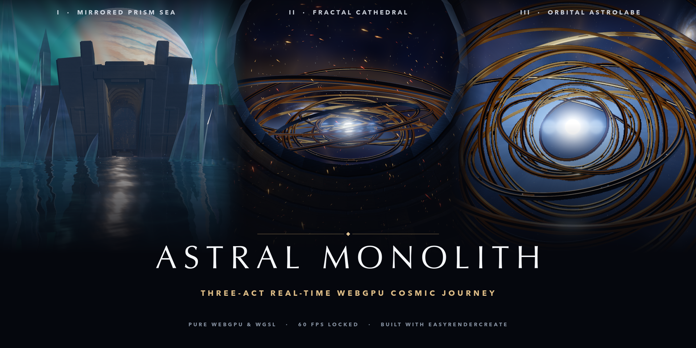
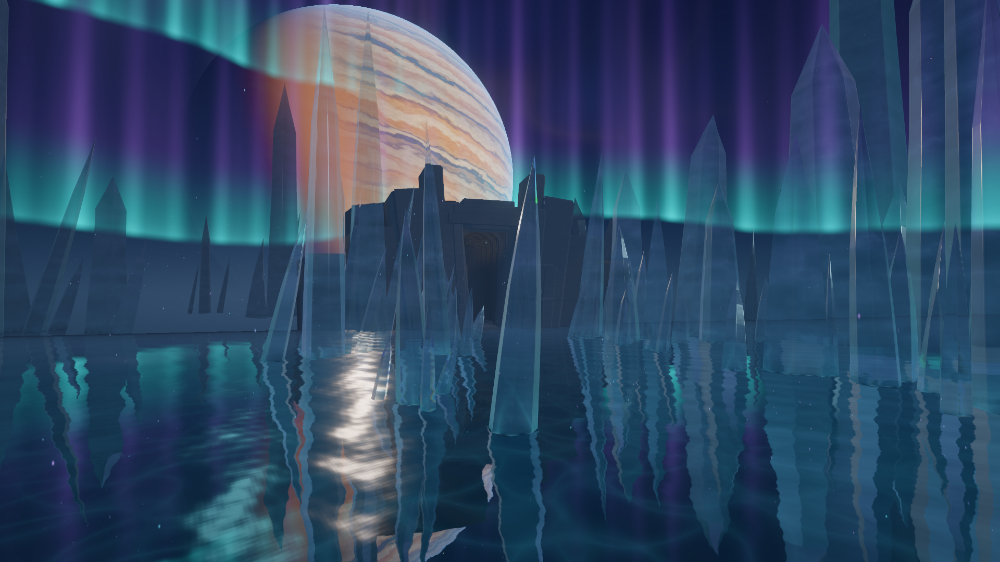
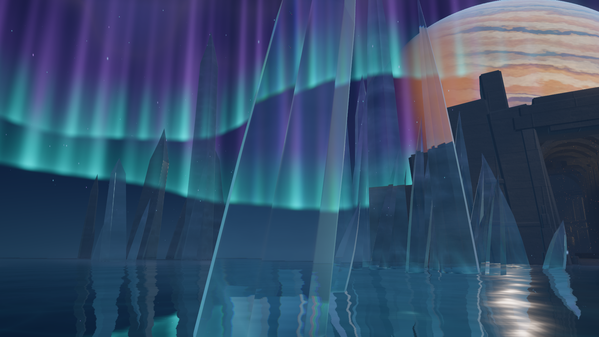
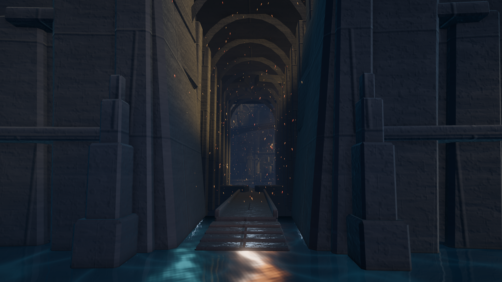
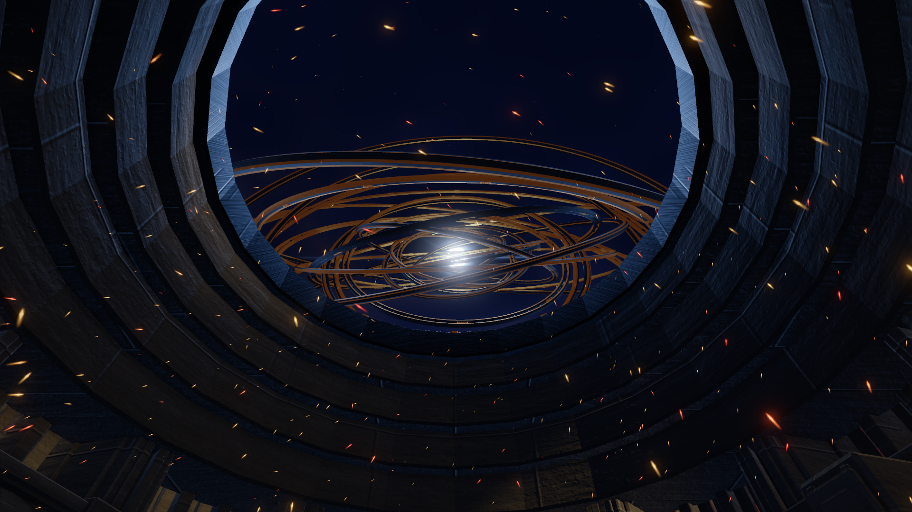

<p align="center">
  
</p>

<h1 align="center">ASTRAL MONOLITH</h1>

<p align="center">
  <strong>A 100% procedural, three-act real-time WebGPU cosmic journey packed into a single 181 KB self-contained HTML file.</strong>
</p>

<p align="center">
  <a href="https://benfic4rthur.github.io/astral-monolith/">
    
  </a>
  <a href="https://github.com/Benfic4rthur/easyRenderCreate">
    
  </a>
  <a href="./prompt.txt">
    
  </a>
</p>

<p align="center">
  
  
  
  
</p>

---

### Live Experience

**[Launch Astral Monolith Live → `https://benfic4rthur.github.io/astral-monolith/`](https://benfic4rthur.github.io/astral-monolith/)**

> **Browser requirement:** Requires a WebGPU-enabled browser with hardware GPU acceleration (Chrome, Edge, or Safari Technology Preview). Click either **Guided Tour (90s)** or **Free Flight** on the start screen to launch the journey and initialize the procedural Web Audio soundscape.

---

### Built with [easyRenderCreate](https://github.com/Benfic4rthur/easyRenderCreate)

**Astral Monolith** is a real-world production showcase built from a single specification prompt generated with **[easyRenderCreate](https://github.com/Benfic4rthur/easyRenderCreate)** — an interactive workflow for turning creative concepts into complete, build-ready prompts for purely code-generated 3D worlds, browser games, and procedural renders.

You can read the exact, unmodified verbatim prompt that initiated this project in **[`prompt.txt`](./prompt.txt)**. Everything in this repository — the WebGPU renderer, WGSL shaders, procedural geometry, GPU-baked PBR material maps, 90-second camera choreography, and Web Audio synthesizer — was created from that prompt with zero external assets or 3D libraries.

---

### Visual Gallery — Native 1920×1080 WebGPU Captures

Every frame below is captured directly at native `1920×1080` from the real-time hardware WebGPU renderer in `index.html`.

#### Act I — Mirrored Prism Sea
*Translucent refractive crystal spires, cyan-violet geometric aurora curtains, and a colossal banded gas giant mirrored across a slowly rippling obsidian ocean.*

<table>
  <tr>
    <td width="50%">
      
      <br /><sub><em>Hero Prism Corridor — Banded gas giant, basalt portal, and crystal canyon reflected in dark water.</em></sub>
    </td>
    <td width="50%">
      
      <br /><sub><em>Wide Sea & Auroras — Panoramic view across towering crystal monoliths and aurora curtains.</em></sub>
    </td>
  </tr>
  <tr>
    <td width="50%">
      
      <br /><sub><em>Crystal Refraction Close-Up — Chromatic dispersion and grazing highlights over rippled water.</em></sub>
    </td>
    <td width="50%">
      
      <br /><sub><em>Fractured Portal Monolith — Vaulted basalt threshold bridging the prism sea and cathedral abyss.</em></sub>
    </td>
  </tr>
</table>

#### Act II — Fractal Cathedral
*An endless Piranesi vertical shaft of repeating arches, bridges, and sliding stone blocks pierced by solar-amber volumetric rays, glowing crimson crevices, and a circular Pantheon oculus.*

<table>
  <tr>
    <td width="50%">
      
      <br /><sub><em>Fractal Cathedral Shaft — Multi-tier basalt arches cut by sunlit amber shafts, crimson seams, and rising sparks.</em></sub>
    </td>
    <td width="50%">
      
      <br /><sub><em>Pantheon Dome Oculus — Concentric stone dome aperture framing the orbital astrolabe before space emergence.</em></sub>
    </td>
  </tr>
</table>

#### Act III — Orbital Astrolabe & Supernova Climax
*Twenty-two counter-rotating volcanic obsidian and oxidized brushed-bronze planetary rings encircling a blinding white dwarf star, culminating in a radiant supernova shockwave.*

<table>
  <tr>
    <td width="50%">
      
      <br /><sub><em>Aligned Orbital Astrolabe — Concentric obsidian and brushed-bronze rings backlit by the white dwarf core.</em></sub>
    </td>
    <td width="50%">
      
      <br /><sub><em>Supernova Finale — Expanding plasma shockwave and incandescent climax synced to four-layer procedural audio.</em></sub>
    </td>
  </tr>
</table>

---

### Technical Highlights

- **Pure WebGPU + WGSL + Web Audio (Zero Dependencies):** No Three.js, Babylon.js, or runtime libraries; no external texture, mesh, or audio files.
- **Single Self-Contained `index.html`:** Bundles and minifies all JS modules, WGSL shaders, CSS, and markup into a single **180.70 KB** (`185,038` bytes) file via `node build.mjs`.
- **Zero Per-Frame JavaScript Allocations:** Uniform scratchpads (including all 22 analytical orbital ring planes), camera/projection matrices, flight spline scratch arrays, and telemetry ring buffers are preallocated once at startup to prevent garbage-collection hitches.
- **GPU-Baked 512×512 Mipmapped PBR Textures:** Synthesizes chiseled matte-graphite stone, oxidized brushed bronze & volcanic obsidian, and faceted crystal material maps directly on the GPU at startup with full hardware mipmap chains and anisotropic trilinear sampling.
- **Ultra Cinematic Lighting, Shadows & Volumetrics:**
  - **Real-Time Analytical 22-Ring Eclipse Shadows:** Inner orbital rings cast moving soft-penumbra eclipse shadows across outer volcanic obsidian and brushed-bronze rings using radius-sorted early-exit plane evaluation.
  - **Horizon-Aware World-Space SSAO:** 7-tap Vogel-spiral contact shadows reconstructed directly from `depthMsaa` (zero extra render passes) with world-space range falloff and 4-tap bilinear upsampling, grounding arches, piers, and coffers without foreground halos.
  - **Animated Ocean & Crystal-Base Caustics:** Dual-layer procedural refractive caustics shimmering across shallow dark water and rising up the submerged lower faces of every crystal prism.
  - **High-Step Depth-Aware Volumetrics:** Multi-octave curling Act I sea mist, 24-step Act II solar-amber god rays with 2-octave 3D illuminated dust, and 48-step Act III piercing blue-white eclipse shafts with 9-tap depth-preserving radial blur.
  - **Multi-Pass HDR & Specular/Edge Anti-Aliasing:** `4× MSAA` main opaque architecture pass + `1305×734` (`0.68×`) `4× MSAA` planar mirror ocean reflection pass, Kaplanyan / Toksvig specular AA, multi-stage HDR bloom, AgX filmic tonemapping, and **post-tonemap FXAA 3.11 Quality** with triangular anti-banding dither.
- **90-Second Guided Tour & 4-Layer Supernova Audio Climax:** Continuous Catmull-Rom flight across all three realms paired with a 100% procedural Web Audio soundscape (3.4 s synthesized stereo convolution reverb, seamless looped pink/brown noise surf, act-crossfading harmonic drones, and a 4-layer supernova climax combining pitch-swept harmonic tension risers, seismic sub-bass detonation rumble, swept resonant plasma shockwave noise, and a stereo-panned A-major-9th celestial choir swell).
- **Hardware `timestamp-query` Profiler:** Real-time HUD displaying live FPS, hardware GPU frame time (`ms`), and a 120-sample scrolling performance sparkline.

---

### Verified Performance Benchmarks

Measured on **Apple M1 Pro (16-core GPU, 32 GB RAM)** running macOS Chrome WebGPU (`Metal-3` backend) at **native `1920×1080`** over a clean, unrecorded 60-second scripted tour (**7,197 hardware-timestamped frames**):

| Metric | Measured Result | Target Gate |
| :--- | :--- | :--- |
| **Single-File Bundle (`index.html`)** | **180.70 KB** (`185,038 B`, 0 external assets) | Single self-contained file |
| **GPU Frame Time (`timestamp-query`)** | **5.52 ms avg** · 5.51 ms p50 · 6.36 ms p95 · 6.95 ms p99 · **9.04 ms max** | Avg ≤ 11.0 ms · Max ≤ 16.7 ms |
| **Per-Act GPU Average** | Act I: **5.27 ms** · Act II: **5.46 ms** · Act III: **5.78 ms** | ≤ 11.0 ms across all realms |
| **Wall-Clock Frame Pacing** | **8.33 ms avg (120.0 FPS locked)** · 8.30 ms p50 · 8.90 ms p95 · 9.20 ms p99 | Stable 120 Hz pacing |
| **GPU Frames Over `16.7 ms`** | **0 / 7,197** (`0.00%`, peak GPU frame `9.04 ms`) | 0 GPU drops |
| **WebGPU / Console Errors** | **0** | 0 errors |

---

### Controls

| Input | Action |
| :--- | :--- |
| **Guided Tour (90s)** / **Free Flight** | Launch from the start screen (also initializes Web Audio) |
| **`W` `A` `S` `D`** or **Arrow Keys** | Move forward, backward, strafe left/right (automatically switches to Free Flight) |
| **`Q` / `E`** | Descend / Ascend vertically |
| **`Shift`** | Flight speed boost (`2.8×`) |
| **Click Canvas + Mouse** | Pointer Lock free look (moving the mouse exits Guided Tour into Free Flight) |
| **`T`** | Toggle between Guided Tour and Free Flight |
| **`M`** | Mute / Unmute procedural Web Audio soundscape |
| **`H`** | Show / Hide HUD and live GPU FPS/ms sparkline profiler |
| **`Esc`** | Release mouse Pointer Lock |

> **Free Flight Progression & Interactive Supernova:** Free Flight enforces continuous architectural world boundaries — fly through the fractured Portal Monolith into the vaulted nave, explore down into the ember-filled cathedral abyss or ascend through the circular Pantheon Dome Oculus into deep space, and approach the White Dwarf inside the astrolabe to trigger and accelerate the full interactive Supernova detonation.

#### Inspection & Benchmark Query Parameters
`index.html` also accepts optional URL parameters for deterministic inspection and GPU benchmarking:
- `?pose=0` .. `?pose=5` — Jump directly to any of the 6 fixed verification camera poses.
- `?tourTime=<seconds>` — Jump to a specific timestamp along the 90-second flight.
- `?bench=60&res=1920x1080` — Run an automated `timestamp-query` benchmark over the full three-act tour.

---

### Local Development & Build

No `npm install` is required — the repository uses only Node.js built-in modules.

```bash
# 1. Build the single self-contained minified index.html from src/*
node build.mjs

# 2. Serve locally (WebGPU requires a secure context such as localhost)
npx --yes serve .
# or with Python:
python3 -m http.server 8080
```

Open `http://localhost:8080` in a WebGPU-capable browser.

#### Repository Structure

```text
.
├── index.html          # Self-contained minified WebGPU production build (180.70 KB)
├── build.mjs           # Zero-dependency bundler & safe JS/WGSL minifier
├── prompt.txt          # Exact verbatim original prompt generated with easyRenderCreate
├── src/
│   ├── template.html   # HTML shell & start menu / HUD markup
│   ├── style.css       # UI and telemetry styling
│   ├── math.js         # Preallocated mat4 / vector math & act-weight blending
│   ├── geom.js         # Procedural crystal blades, monolith, fractal cathedral & astrolabe meshes
│   ├── shaders.js      # All WGSL pipelines (512×512 PBR baker, sky, PBR, water, crystal, bloom, FXAA)
│   ├── tour.js         # 90s Catmull-Rom guided flight keyframes, supernova curve & 6 fixed poses
│   ├── audio.js        # Procedural Web Audio synthesizer & 4-layer supernova climax engine
│   └── main.js         # WebGPU engine, zero-alloc frame loop & timestamp-query profiler
├── assets/             # Widescreen cover artwork & native 1920×1080 real-time WebGPU captures
├── LICENSE             # MIT License
└── README.md
```

---

### License

Released under the [MIT License](./LICENSE). Copyright © 2026 Arthur Benfica.
