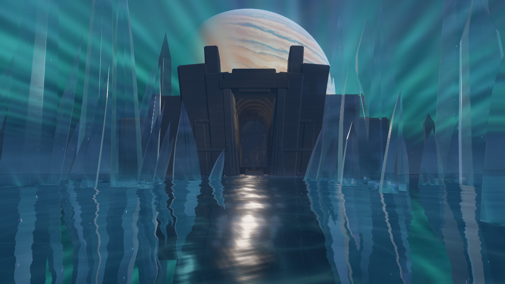
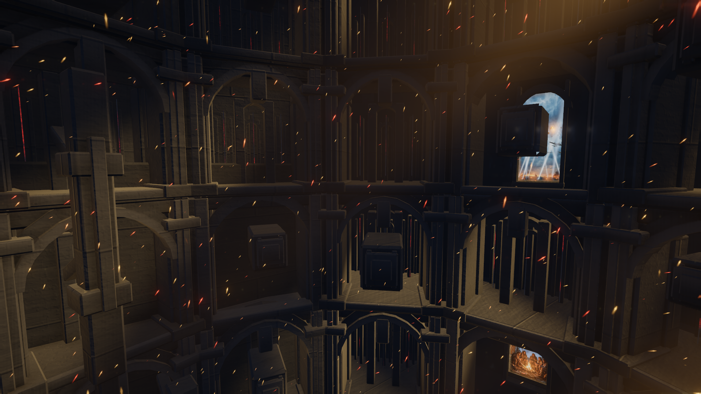
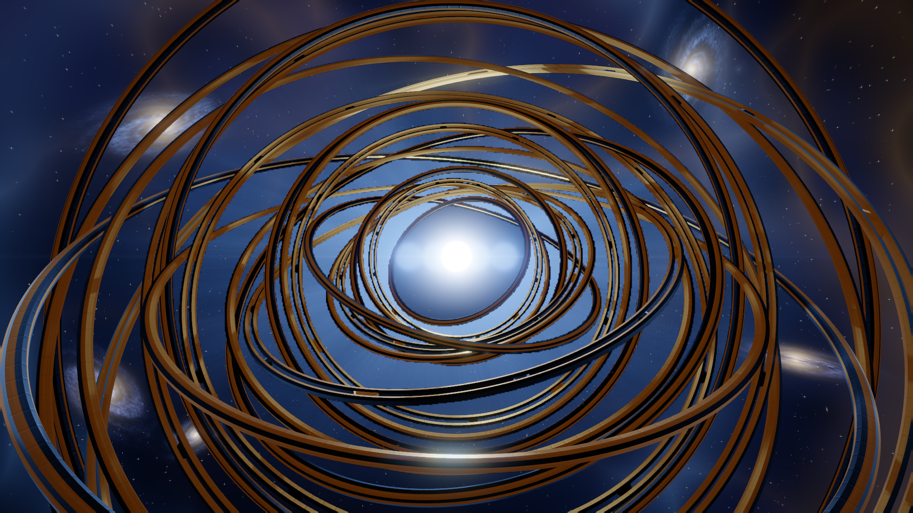
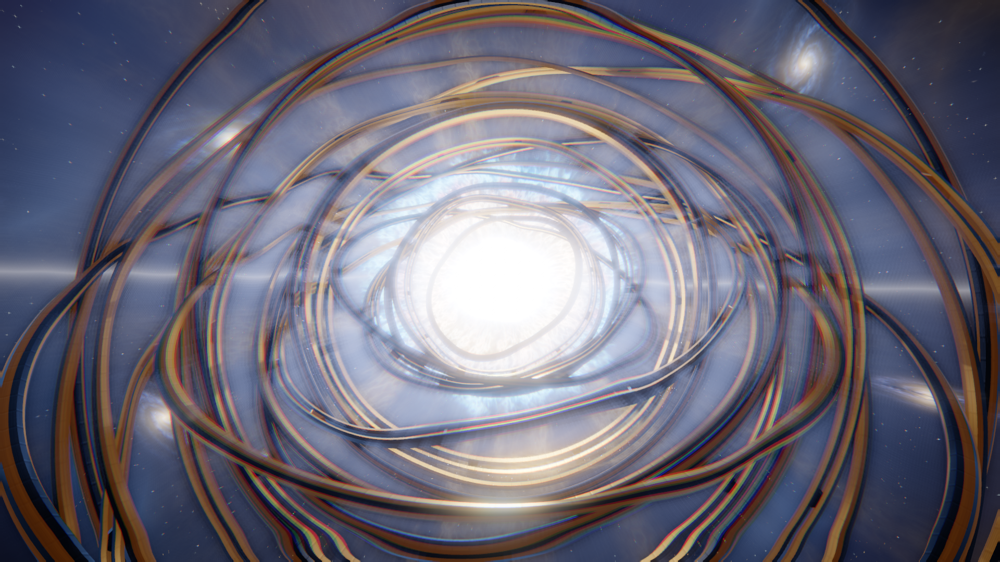

<p align="center">
  
</p>

<h1 align="center">ASTRAL MONOLITH</h1>

<p align="center">
  <strong>A three-act real-time WebGPU cosmic journey — pure WGSL shaders, 6 living Time-Era cathedral portals, deep-field galaxies, and reverse-tape Web Audio packed into a single 767 KB self-contained HTML file.</strong>
</p>

<p align="center">
  <a href="https://benfic4rthur.github.io/astral-monolith/">
    
  </a>
  <a href="https://github.com/Benfic4rthur/easyRenderCreate">
    
  </a>
  <a href="./prompt.txt">
    
  </a>
</p>

<p align="center">
  
  
  
  
</p>

---

### Live Experience

**[Launch Astral Monolith Live → `https://benfic4rthur.github.io/astral-monolith/`](https://benfic4rthur.github.io/astral-monolith/)**

> **Browser requirement:** Requires a WebGPU-enabled browser with hardware GPU acceleration (Chrome, Edge, or Safari Technology Preview). Click **Guided Tour (90s)** or **Free Flight** on the start screen to dissolve the menu into cosmic sand, launch seamlessly with zero camera cut, and initialize the procedural Web Audio + reverse-tape engine.

---

### Built with [easyRenderCreate](https://github.com/Benfic4rthur/easyRenderCreate)

**Astral Monolith** is a real-world production showcase built from a single specification prompt generated with **[easyRenderCreate](https://github.com/Benfic4rthur/easyRenderCreate)** — an interactive workflow for turning creative concepts into complete, build-ready prompts for code-generated 3D worlds, browser games, and procedural renders.

You can read the exact, unmodified verbatim prompt that initiated this project in **[`prompt.txt`](./prompt.txt)**. Everything in this repository — the WebGPU renderer, WGSL shaders, procedural geometry, `1024×1024` GPU-baked PBR material maps, embedded 6-layer WebP Time-Era cathedral portal atlas, 90-second camera choreography, and real-time reverse-tape Web Audio synthesizer — builds into a single self-contained `index.html` with zero external runtime fetches or 3D libraries.

---

### Visual Gallery — Native 1920×1080 WebGPU Captures

Every frame below is captured directly at native `1920×1080` from the real-time hardware WebGPU renderer in `index.html`.

#### Act I — Mirrored Prism Sea
*Translucent spectral-refractive quartz spires, 3D raymarched volumetric aurora curtains, and a colossal banded gas giant mirrored across a 14-wave obsidian ocean with underwater parallax caustics.*

<table>
  <tr>
    <td width="50%">
      
      <br /><sub><em>Hero Prism Corridor — Banded gas giant, 3D volumetric auroras, basalt portal, and crystal canyon reflected in caustic dark water.</em></sub>
    </td>
    <td width="50%">
      
      <br /><sub><em>Wide Sea & Volumetric Auroras — Panoramic view across towering refractive quartz monoliths and layered aurora curtains.</em></sub>
    </td>
  </tr>
  <tr>
    <td width="50%">
      
      <br /><sub><em>Spectral Crystal Refraction — 5-band chromatic rainbow dispersion and internal parallax facets rising from rippled water.</em></sub>
    </td>
    <td width="50%">
      
      <br /><sub><em>Fractured Portal Monolith — Vaulted basalt threshold bridging the prism sea and the spark-filled cathedral shaft.</em></sub>
    </td>
  </tr>
</table>

#### Act II — Fractal Cathedral & Living Time-Era Portals
*An endless Piranesi vertical shaft of repeating arches, bridges, and sliding stone blocks pierced by solar-amber volumetric rays, glowing crimson crevices, six widely spaced living portal windows gazing into different eras of history, and a circular Pantheon oculus.*

<table>
  <tr>
    <td width="50%">
      
      <br /><sub><em>Fractal Cathedral & Time-Era Portals — Basalt arches cut by sunlit amber shafts, drifting embers, and living 3D-parallax portals glimpsing WWII searchlights (upper right) and Stone Age cavemen around a campfire (lower right).</em></sub>
    </td>
    <td width="50%">
      
      <br /><sub><em>Pantheon Dome Oculus — Concentric stone dome aperture framing the smooth 240-segment orbital astrolabe and deep-field cosmos before space emergence.</em></sub>
    </td>
  </tr>
</table>

#### Act III — Orbital Astrolabe, Deep-Field Galaxies & Supernova Climax
*Twenty-two smooth 240-segment counter-rotating volcanic obsidian and oxidized brushed-bronze planetary rings encircling a blinding white dwarf star against a deep-field universe of spiral and Sombrero galaxies, culminating in an invisible-radiation spacetime-distortion supernova shockwave.*

<table>
  <tr>
    <td width="50%">
      
      <br /><sub><em>Aligned Orbital Astrolabe — 240-segment obsidian and brushed-bronze rings with real-time 22-ring analytical eclipse shadows set against deep-field spiral and Sombrero galaxies.</em></sub>
    </td>
    <td width="50%">
      
      <br /><sub><em>Supernova Finale — Expanding invisible-radiation spacetime-distortion wavefronts bending the astrolabe rings and starfield around the incandescent detonation, synced to four-layer procedural audio.</em></sub>
    </td>
  </tr>
</table>

---

### Technical Highlights

- **Pure WebGPU + WGSL + Web Audio (Zero Dependencies):** No Three.js, Babylon.js, or external runtime libraries; zero network fetches at runtime.
- **Single Self-Contained `index.html`:** Bundles and minifies all JS modules, WGSL shaders, CSS, inline orbital-rings SVG favicon, and the 6-layer `512×896` WebP Time-Era cathedral portal atlas into a single **767.27 KB** (`785,686` bytes) file via `node build.mjs`.
- **Phase-Locked `60.0 FPS` Cinema Pacer:** Exact `16.67 ms` (`1000/60`) vblank-locked frame pacing with constant `1/60s` on-phase simulation steps, delivering a flat frametime graph with zero micro-stutter on both 60 Hz and 120 Hz ProMotion displays (`?uncapped=1` override available).
- **Zero Per-Frame JavaScript Allocations:** Uniform scratchpads (including all 22 analytical orbital ring planes), camera/projection matrices, flight spline scratch arrays, and telemetry ring buffers are preallocated once at startup to prevent garbage-collection hitches.
- **GPU-Baked `1024×1024` Mipmapped PBR Textures:** Synthesizes chiseled matte-graphite stone, oxidized brushed bronze & volcanic obsidian, and faceted quartz crystal material maps directly on the GPU at startup with full 11-level hardware mipmap chains and 8× anisotropic trilinear sampling.
- **Six Widely Spaced Living Time-Era Cathedral Portals:** Decoded at startup into a 6-layer mipmapped WebGPU `texture_2d_array` (`[512, 896, 6]`) spiraling chronologically across the cathedral tiers — **Dinosaurs**, **Stone Age Cavemen**, **Knights Templar**, **World War II**, **Modern New York City**, and **Humans Colonizing Mars**. Every portal combines real-time 3D view-angle depth parallax with continuous aperiodic GPU animations (volcanic plumes/embers/soaring pterosaur, chaotic campfire flicker, billowing banners, sweeping WWII searchlights & randomized flak bursts, twinkling NYC skyline/river traffic, and Martian dust/Starship cryogenic vents) that never visibly repeat even while hovering close in Free Flight.
- **Universal Cosmic Sand Menu & Zero-Cut Launch:** Synchronized diagonal CSS masking erodes the live HTML start menu into ~8,500 sparkling golden-cyan stardust grains swept away by wind right on the Hero Prism Corridor pose — zero camera cut into Guided Tour or Free Flight. Rewinding the Guided Tour back to `0.0s` reverses the wind and condenses the sand back into the clickable menu.
- **Interactive Time Scrubbing (`A` −3× / `D` +3×) & Real-Time Reverse-Tape `AudioWorklet`:** Holding `D` / `→` fast-forwards the Guided Tour at `+3×`; holding `A` / `←` rewinds time at `−3×` through an inline zero-allocation `AudioWorklet` (`TapeTimeProcessor`) backed by a 40-second stereo circular PCM tape buffer that plays the exact recorded audio mix backwards 1:1 with visuals, seamlessly crossfading into overlapping Hann-windowed live reverse grains if rewinding past 40 seconds.
- **Ultra Cinematic Lighting, Shadows, Galaxies & Spacetime Distortion:**
  - **Smooth 240-Segment Astrolabe & Real-Time 22-Ring Eclipse Shadows:** Circumferentially smooth rings with Kaplanyan/Toksvig specular AA and radius-sorted early-exit soft-penumbra eclipse shadows cast across outer volcanic obsidian and brushed-bronze rings.
  - **Beyond-Time Deep-Field Cosmos:** 8 bespoke procedural spiral & edge-on Sombrero galaxies with seamless C2 boundary falloff, dark interstellar dust lanes, embedded arm stars, cosmic web filaments, gravitational-lensing horizon arcs, and a 4-layer diffraction-spike starfield.
  - **Seamless 360° Invisible Radiation Spacetime Distortion:** Outward-radiating Cartesian noise shockwaves and Einstein gravitational lensing bend the rings and starfield around the Supernova core with subtle optical chromatic dispersion and zero polar seams.
  - **3D Volumetric Auroras, Spectral Quartz & Parallax Caustics:** 6-step altitude-slab raymarched aurora curtains, 5-band spectral rainbow quartz crystals with 3-depth internal parallax facets, and a 14-wave mirrored obsidian ocean (`0.62×` `4× MSAA` reflection) with Snell-refracted underwater caustics.
  - **Multi-Pass HDR, Dual-Scale GTAO & FXAA 3.11:** Native `1920×1080` `4× MSAA` main pass, `0.55×` (`1056×594`) depth-aware volumetrics & 8-tap dual-scale GTAO, 4-mip HDR bloom pyramid, AgX filmic tonemapping, and post-tonemap **FXAA 3.11 Quality** with triangular anti-banding dither.
- **Hardware `timestamp-query` Profiler:** Real-time HUD displaying live 60 FPS lock status, hardware GPU frame time (`ms`), and a 120-sample scrolling performance sparkline.

---

### Verified Performance Benchmarks

Measured on **Apple M1 Pro (16-core GPU, 32 GB RAM)** running macOS Chrome WebGPU (`Metal-3` backend) at **native `1920×1080`** over a clean, unrecorded 60-second scripted tour (**3,600 hardware-timestamped frames**, phase-locked to 60 FPS):

| Metric | Measured Result | Target Gate |
| :--- | :--- | :--- |
| **Single-File Bundle (`index.html`)** | **767.27 KB** (`785,686 B`, embeds 6-layer WebP Time-Era atlas, 0 external requests) | Single self-contained file |
| **GPU Frame Time (`timestamp-query`)** | **6.79 ms avg** · 4.72 ms min · 6.68 ms p50 · 8.26 ms p95 · 9.90 ms p99 · **12.91 ms max** | Avg ≤ 11.0 ms · Max ≤ 16.7 ms |
| **Per-Act GPU Average** | Act I: **7.23 ms** · Act II: **6.42 ms** · Act III: **6.76 ms** | ≤ 11.0 ms across all realms |
| **Wall-Clock Frame Pacing** | **16.67 ms avg (60.0 FPS locked)** · 16.70 ms p50 · 17.20 ms p95 · 17.60 ms p99 · **18.50 ms max** | Locked 60 Hz pacing |
| **GPU Frames Over `16.7 ms`** | **0 / 3,600** (`0.00%`, peak GPU frame `12.91 ms`) | 0 GPU drops |
| **Missed 60 Hz Vblanks (`> 20 ms`)** | **0 / 3,600** (`0.00%`) | 0 frame drops |
| **WebGPU / Console Errors** | **0** | 0 errors |

---

### Controls

| Input | Action |
| :--- | :--- |
| **Guided Tour (90s)** / **Free Flight** | Dissolve the start screen into cosmic sand, launch seamlessly, and initialize Web Audio |
| **`A` / `←`** *(Guided Tour)* | Rewind time backwards at **`−3×`** with **real-time reversed stereo tape audio**; rewinding to `0.0s` reassembles the Start Menu from sand |
| **`D` / `→`** *(Guided Tour)* | Advance time forward at **`+3×`** with accelerated cosmic tape audio |
| **`W` `S` `Q` `E`** or **`↑` `↓`** *(Guided Tour)* | Seamlessly take over into **Free Flight** (`WASD` / `Arrows` move & strafe; `Q` / `E` descend & ascend) |
| **`Shift`** *(Free Flight)* | Flight speed boost (`2.8×`) |
| **Click Canvas + Mouse** | Pointer Lock free look (moving the mouse exits Guided Tour into Free Flight) |
| **`T`** | Toggle between Guided Tour and Free Flight |
| **`M`** | Mute / Unmute procedural Web Audio & reverse-tape engine |
| **`H`** | Show / Hide HUD and live GPU FPS/ms sparkline profiler |
| **`Esc`** | Release mouse Pointer Lock |

> **Free Flight Progression & Living Portals:** Free Flight enforces continuous architectural world boundaries — fly through the fractured Portal Monolith into the vaulted nave, pause beside any of the six living Time-Era cathedral portals to watch their continuous aperiodic animations and 3D depth parallax, ascend through the circular Pantheon Dome Oculus into the deep-field galaxy space, and approach the White Dwarf inside the astrolabe to trigger and accelerate the full interactive Supernova detonation.

#### Inspection & Benchmark Query Parameters
`index.html` also accepts optional URL parameters for deterministic inspection and GPU benchmarking:
- `?pose=0` .. `?pose=5` — Jump directly to any of the 6 fixed verification camera poses.
- `?tourTime=<seconds>` — Jump to a specific timestamp along the 90-second flight.
- `?bench=60&res=1920x1080` — Run an automated `timestamp-query` benchmark over the full three-act tour.
- `?uncapped=1` — Disable the 60 FPS phase-locked pacer for raw uncapped framerate testing.

---

### Local Development & Build

No `npm install` is required — the repository uses only Node.js built-in modules.

```bash
# 1. Build the single self-contained minified index.html from src/*
node build.mjs

# 2. Serve locally (WebGPU requires a secure context such as localhost)
npx --yes serve .
# or with Python:
python3 -m http.server 8080
```

Open `http://localhost:8080` in a WebGPU-capable browser.

#### Repository Structure

```text
.
├── index.html          # Self-contained minified WebGPU production build (767.27 KB)
├── build.mjs           # Zero-dependency bundler & safe JS/WGSL minifier
├── prompt.txt          # Exact verbatim original prompt generated with easyRenderCreate
├── src/
│   ├── template.html   # HTML shell, orbital-rings SVG favicon & start menu / HUD markup
│   ├── style.css       # UI, sand-mask transition & telemetry styling
│   ├── math.js         # Preallocated mat4 / vector math & act-weight blending
│   ├── geom.js         # Crystal spires, monolith, cathedral w/ 6 Time-Era portals & 240-seg astrolabe
│   ├── eras_atlas.js   # Embedded 6-layer WebP IMAX Time-Era cathedral portal atlas
│   ├── shaders.js      # WGSL pipelines (1024×1024 PBR baker, 3D auroras, Time-Era parallax, galaxies, spacetime warp, FXAA)
│   ├── tour.js         # 90s Catmull-Rom guided flight keyframes, supernova curve & 6 fixed poses
│   ├── audio.js        # Procedural Web Audio synthesizer, 40s reverse-tape AudioWorklet & sand-sweep FX
│   └── main.js         # WebGPU engine, 60 FPS phase-locked pacer, MenuSandFX & timestamp-query profiler
├── assets/             # Widescreen cover triptych & native 1920×1080 real-time WebGPU captures
├── LICENSE             # MIT License
└── README.md
```

---

### License

Released under the [MIT License](./LICENSE). Copyright © 2026 Arthur Benfica.
